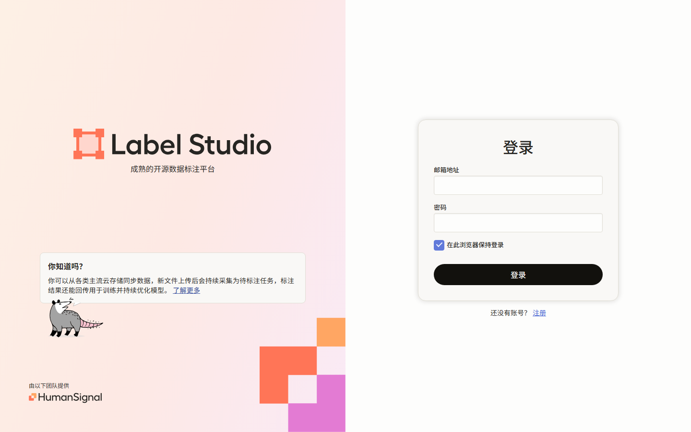

# Label Studio 简体中文汉化补丁

给 **官方 Label Studio 1.23.0 镜像**打中文补丁：只替换界面文案，不改后端逻辑、不动数据库、不锁版本。

> 一句话原理：Label Studio 前端没有 i18n 框架（`USE_I18N = False`，文案全部硬编码在 React 组件里），所以本补丁通过**构建期替换前端构建产物中的字符串字面量** + **替换 Django 模板文字** 来实现汉化，词库约 1400 条。



- 适配版本：`heartexlabs/label-studio:1.23.0`（其他版本可通过 `--build-arg BASE_IMAGE=...` 尝试）
- 改动位置：`/label-studio/web/dist/**/*.js`、`/label-studio/label_studio/**/templates/**/*.html`
- 不包含内容：Label Studio 源码、构建产物、二进制镜像（本仓库只有补丁脚本 + 词库）
- 实测：13/13 前端 chunk 替换后仍可被 `@babel/parser` 完整解析；前端中文字符 14227 个；仍为英文的显示位文案 73 条（多为日期格式、CSS 上下文、示例存储桶名等非界面文案）

---

## 为什么不直接用 MindAsAI/label-studio-chinese

| 对比项 | [MindAsAI/label-studio-chinese](https://github.com/MindAsAI/label-studio-chinese) | 本项目 |
| --- | --- | --- |
| 代码基线 | Label Studio **1.18.0**（整仓 fork） | 官方 **1.23.0** 镜像 + 补丁层 |
| 汉化程度 | 部分汉化（作者注明"完整汉化"在付费企业版） | 主流程界面约 1400 条文案 |
| 后端改动 | 含作者自定义逻辑（用户数据隔离、data 表、企业版模块） | **零后端改动** |
| 升级现有实例 | 1.23 数据库降级到 1.18 会触发迁移记录不一致（`InconsistentMigrationHistory`），有数据风险 | 版本不变，只换镜像 |
| 交付形态 | 需要自行构建前后端（Node/Poetry） | 一条 `docker build` |

结论：如果你的实例是**已经在用**的 1.23.0（含项目、任务、标注数据），本补丁是安全的做法；如果你想从零体验作者的定制版，可以直接用他的仓库。

---

## 效果范围

已汉化：

- 登录 / 注册页面，账户与组织设置
- 项目列表、创建项目、项目设置
- 数据管理器（Data Manager）：导入、导出、筛选、列设置、批量操作
- 标注界面：顶部工具栏、底部按钮（提交/更新/跳过）、快捷键提示、图层列表（Outliner）、区域属性、评论、审核
- 常见对话框、空状态、提示语

保留英文：

- 品牌与技术专名：Label Studio、Amazon S3、Google Cloud Storage、Azure、Redis、OpenAI、JSON、CSV、API、URL 等
- 后端返回的提示语 / 校验错误、标注模板库（`annotation_templates`）、邮件通知、日期格式
- 少数运行时动态拼接的文案

---

## 快速开始

### 1. 构建汉化镜像

```bash
git clone https://github.com/1204LD/label-studio-zh.git
cd label-studio-zh

# 默认基于 heartexlabs/label-studio:1.23.0
docker build -t label-studio-zh:1.23.0 .
```

### 2. 用原数据目录启动

把数据卷（`/label-studio/data`）指向你原来的目录即可，项目和标注数据全部保留：

```bash
docker stop label-studio && docker rm label-studio   # 停掉原来的官方实例

docker run -d --name label-studio-zh \
  -p 8080:8080 \
  -v /your/data/dir:/label-studio/data \
  -e SSRF_PROTECTION_ENABLED=true \
  -e LABEL_STUDIO_LOCAL_FILES_SERVING_ENABLED=true \
  -e LABEL_STUDIO_LOCAL_FILES_DOCUMENT_ROOT=/label-studio/data/files \
  -e LABEL_STUDIO_DISABLE_UPDATE_CHECK=true \
  -e COLLECT_ANALYTICS=false \
  -e LABEL_STUDIO_SECRET_KEY=your_secret_key \
  label-studio-zh:1.23.0
```

Windows PowerShell 写法：

```powershell
docker run -d -p 8080:8080 --name label-studio-zh `
  -v D:\LabelStudioData:/label-studio/data `
  -e SSRF_PROTECTION_ENABLED=true `
  -e LABEL_STUDIO_LOCAL_FILES_SERVING_ENABLED=true `
  -e LABEL_STUDIO_LOCAL_FILES_DOCUMENT_ROOT=/label-studio/data/files `
  -e LABEL_STUDIO_DISABLE_UPDATE_CHECK=true `
  -e COLLECT_ANALYTICS=false `
  -e LABEL_STUDIO_SECRET_KEY=my_super_secret_key_123 `
  label-studio-zh:1.23.0
```

浏览器打开 <http://localhost:8080>，登录页与工作台即中文。

> 注意 `LABEL_STUDIO_SECRET_KEY` 必须与原来一致，否则已登录会话失效（数据不受影响）。

### 3. 回滚

```bash
docker stop label-studio-zh && docker rm label-studio-zh
docker start label-studio        # 原来的官方容器
```

镜像层是叠加的，原始官方镜像 `heartexlabs/label-studio:1.23.0` 不会被修改。

---

## 升级到新的 Label Studio 版本

```bash
docker build --build-arg BASE_IMAGE=heartexlabs/label-studio:1.24.0 -t label-studio-zh:1.24.0 .
```

新版本新增的文案会保持英文（不会报错），可参照 `scripts/` 里的流程补词条。

---

## 原理与实现

1. **文案抽取**：官方镜像的 `web/dist/**/*.js` 旁边带有 sourcemap，其 `sourcesContent` 里是完整原始源码（TSX/JSX）。用 `@babel/parser` 解析 AST，抽取：
   - JSX 文本节点（`<Button>Save</Button>` → `Save`）
   - `title` / `placeholder` / `label` / `aria-label` / `tooltip` / `description` 等属性值
2. **翻译与分类**：对每条文案在构建产物中的**实际出现位置**做上下文判定：
   - 只出现在显示位（`children:"…"`、`title:"…"` 等）→ 可安全翻译
   - 出现在严格比较（`==="…"`）、对象键、方括号动态取值位置 → **拒绝翻译**（这类文案是逻辑值，翻译会引发功能异常）
3. **注入**：构建期在镜像内替换 `web/dist` 里的字符串字面量：
   - `dict/zh-CN.json`：已通过上下文审计、可全局替换的词条
   - `dict/zh-CN-context.json`：只允许在 `children` / `title` / `label` / `placeholder` / `tooltip` / `aria-label` 等显示位替换的词条（更保守）
   - `dict/zh-CN-templates.json`：Django 模板文字
4. **校验**：替换后所有 chunk 仍能被 `@babel/parser` 完整解析（本项目实测 13/13 通过），并统计中文覆盖量。

只替换**完整的字符串字面量**（`"Save"` → `"保存"`），不做子串替换，因此不会破坏 `SaveChanges` 这类标识符。

---

## 目录结构

```
.
├── Dockerfile                  # 基于官方镜像叠加汉化层
├── dict/
│   ├── zh-CN.json              # 全局替换词库（界面文案）
│   ├── zh-CN-context.json      # 仅显示位替换词库（短词/易冲突词）
│   └── zh-CN-templates.json    # Django 模板词库
├── scripts/
│   ├── patch_bundles_global.py # 全局字面量替换
│   ├── patch_bundles_context.py# 显示位限定替换
│   ├── patch_templates.py      # 模板文字替换
│   └── verify.py               # 汉化覆盖率自检
└── docs/GLOSSARY.md            # 术语表
```

## 自检

```bash
docker run --rm --entrypoint python label-studio-zh:1.23.0 \
  /tmp/verify.py 2>/dev/null || \
docker cp label-studio-zh:/label-studio/web/dist ./dist && python scripts/verify.py ./dist
```

输出示例：

```
chunks parsed ok: 13/13
CJK characters in bundles: 14227
residual english display strings: 73   # 多为日期格式、CSS 上下文、存储桶示例等非界面文案
```

## 自定义词库

`dict/zh-CN.json` 是普通 JSON（`"英文": "中文"`），直接增删词条后重新 `docker build` 即可。新增词条建议先按 `zh-CN-context.json` 的方式（只在显示位替换）验证，确认该词没有被代码当作逻辑值使用后，再放进全局词库。

## 贡献

欢迎 PR 补充词条或适配新版本。提交前请确保：
1. 词条已在对应版本的 `web/dist` 中出现；
2. 未被用于比较 / 对象键；
3. `python scripts/verify.py` 通过。

## 许可与致谢

- 本项目（补丁脚本与翻译词库）以 **Apache-2.0** 发布。
- [Label Studio](https://github.com/HumanSignal/label-studio) 由 HumanSignal 开发，同样以 Apache-2.0 发布；本仓库**不包含**其源码或镜像，仅在运行时对已安装实例的构建产物做文字替换，请遵守其许可证与商标政策。
- 思路参考了 [MindAsAI/label-studio-chinese](https://github.com/MindAsAI/label-studio-chinese)（1.18 分支汉化方案）。
